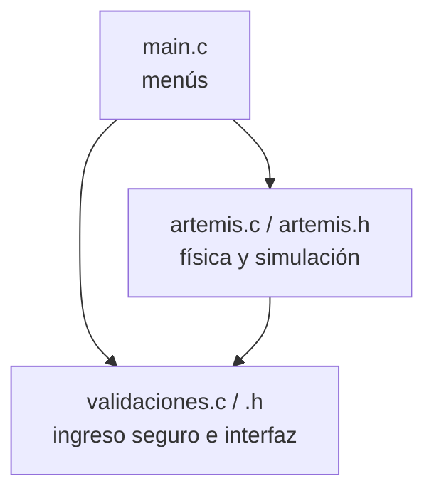

# Simulador de Misiones Artemis — Problema 3: Inyección Translunar (TLI)

**Equipo KERNEL PANIC** · Trabajo Práctico Integrador Final · Algoritmos y Estructuras de Datos · UTN FRRe · Ingeniería en Sistemas de Información

## a) Integrantes y comisión

| Integrante | Legajo | Rol / módulos principales |
|------------|--------|---------------------------|
| Medina, Agostina Magali | 27867 | Base del proyecto: Makefile, .gitignore, README.md, casos de prueba (tests/) |
| [completar] | [completar] | [completar] |
| [completar] | [completar] | [completar] |
| [completar] | [completar] | [completar] |
| [completar] | [completar] | [completar] |

**Comisión:** [D] · **Repositorio:** [https://github.com/agostinaMagali/tfi-artemis-c/tree/main]

## b) Escenario Artemis asignado y reglas del juego

**Situación:** estando en órbita baja (LEO), la etapa ICPS ejecuta la Inyección Translunar (TLI) y la nave Orion
(m = 26.000 kg) queda con motores apagados, a v_TLI = 10.900 m/s, rumbo a la Luna (D = 384.000 km).

**Reglas del juego**

1. Al iniciar hay un **menú de presentación** (comenzar, historia, reglas, créditos).
2. En el menú principal se configuran los parámetros de la misión (masa, velocidad de TLI, altura de LEO y distancia Tierra–Luna) o se usan los valores del enunciado.
3. La simulación se juega **por turnos**: en cada turno el jugador elige cuántas horas avanza la nave (1–48 h) o aborta (0).
4. Con los motores apagados solo actúa la gravedad (1.ª Ley de Newton): la nave se desacelera por la atracción terrestre.
5. **Objetivo:** llegar por inercia al punto de equilibrio gravitatorio Tierra–Luna (r_eq ≈ 345.672 km). Si la velocidad se anula antes, la nave alcanza su apogeo y vuelve a la Tierra.
6. Al final se muestra un **reporte de desempeño** (resultado, historial por turno, progreso, Δv faltante y verificación de la conservación de la energía).

> **Dato importante:** con la velocidad del enunciado (10.900 m/s) el modelo da una velocidad mínima de ≈ 10.905,2 m/s.
> La nave queda ≈ 5,2 m/s corta (≈ 90,8 % del camino). Con 10.950 m/s la misión se cumple.

## c) Funcionamiento y arquitectura



| Archivo | Responsabilidad |
|---------|-----------------|
| `main.c` | Solo `main()` y menús (presentación, principal y configuración) |
| `artemis.h` | Constantes `#define`, `struct Mision`, `Punto`, `Reporte`, enums y prototipos |
| `artemis.c` | Física, integración numérica (Velocity-Verlet), ciclo por turnos, logos de presentación y reportes |
| `validaciones.h/.c` | `leer_entero`, `leer_doble`, `leer_si_no` (basados en `fgets` + `strtol`/`strtod`) y mensajes de error |

**Modelo físico.** La nave se mueve sobre la recta Tierra–Luna (1D) con la Luna fija a distancia D:

- Potencial específico: U(r) = −GM_T/r − GM_L/(D − r)
- Aceleración: a(r) = −GM_T/r² + GM_L/(D − r)²
- Punto de equilibrio: r_eq = D / (1 + √(M_L/M_T))
- La misión tiene éxito si v_TLI ≥ √(2·(U(r_eq) − U(r₁))).

**Requisitos técnicos cubiertos:** estructuras condicionales y repetitivas, modularización, arreglos y punteros
(`Reporte.historial[]`, paso de `struct` por puntero), validaciones exhaustivas (letras, vacíos, rangos, `nan`/`inf`,
líneas largas y fin de entrada) y mensajes de error uniformes.

## Personalización rápida

| Qué cambiar | Dónde |
|-------------|-------|
| Logo de la pantalla de inicio (7 diseños pedidos a claude, o 0 = al azar) | `artemis.h` → `#define LOGO_ELEGIDO` |
| Nombres de los integrantes en "Créditos" | `artemis.c` → `mostrar_creditos()` |
| Valores por defecto del enunciado | `artemis.h` → `DEF_MASA`, `DEF_V_TLI`, `DEF_ALTURA`, `DEF_DIST_TL` |
| Rangos permitidos al ingresar datos | `artemis.h` → `MIN_*` / `MAX_*` (y los textos de las preguntas en `main.c`) |

## d) Compilación y ejecución

Requisitos: `gcc` (y opcionalmente `make`).

```bash
gcc -std=c99 -Wall -Wextra -O2 main.c artemis.c validaciones.c -o artemis_tli -lm
./artemis_tli        # Windows PowerShell: .\artemis_tli
```

Con `make`: `make` compila, `make run` compila y ejecuta, `make clean` limpia.
Si los acentos se ven mal en Windows, ejecutar `chcp 65001`.

## e) Registro de uso de Inteligencia Artificial

> **Completar y ajustar por el equipo.** Este registro debe reflejar lo que el grupo realmente hizo.

| Herramienta | Tarea | Prompt / consulta (resumen) | Cómo se validó / adaptó |
|-------------|-------|------------------------------|--------------------------|
| Claude (Anthropic) | Resolución analítica de los incisos a–d | Se pasó el enunciado del Problema 3 y se pidió la resolución base para guia | [Se valido las funciones del logo, la resolucion de problema con los errores, luego se edito las consignas para adaptar mejor al igual que los credtios, tambien simplificamos el artemis.c para hacerlo menos complejo a lo que la IA nos brindaba ya que nos daba cosas avanzadas] |
| Claude (Anthropic) | Esqueleto modular del proyecto en C | Se pidió preparar los módulos, el Makefile y el README | [Esta fue una funcion que nos gusto para poder ejecutar con .exe y por terminal] |

## Casos de prueba sugeridos

| Caso | Entrada | Resultado esperado |
|------|---------|--------------------|
| Valores del enunciado | v = 10.900 m/s, turnos de 48 h | "INSUFICIENTE", Δv faltante ≈ 5,2 m/s |
| Misión exitosa | v = 10.950 m/s, turnos de 48 h | "MISIÓN CUMPLIDA" a ≈ 55 h |
| Letras en lugar de números | `abc`, `nan`, `1e99` | Mensaje de error y se vuelve a pedir |
| Fuera de rango | v = 99 | Mensaje con el rango permitido |
| Coma decimal | `10900,5` | Se acepta |
| Abortar | `0` en un turno | "MISIÓN ABORTADA" y reporte parcial |
| Fin de entrada (Ctrl+D) | — | Cierre ordenado sin bucle infinito |
