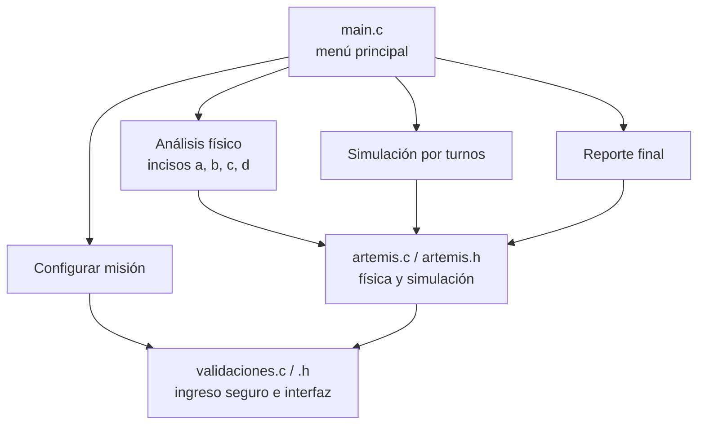

# Simulador de Misiones Artemis – Problema 3: Inyección Translunar (TLI)

Trabajo Práctico Integrador Final · Algoritmos y Estructuras de Datos
UTN – Facultad Regional Resistencia · Ingeniería en Sistemas de Información · Lenguaje C

- **Video de presentación:** [completar enlace]

## a) Integrantes y comisión

**Comisión:** k1.4

| Medina, Agostina Magali | 27867 | AgostinaMaagali | Base del proyecto: Makefile, README, casos de prueba | <br> <br>
| completar | completar | completar | Menú principal (`main.c`) | <br> <br>
| completar | completar | completar | Validaciones (`validaciones.c/.h`) | <br> <br>
| Vallejos, Priscila Jaquelin | 30685 | priscivallejos | Estructuras, constantes y cálculos físicos (`artemis.h`, `artemis.c`) | <br> <br>
| completar | completar | completar | Simulación por turnos y reporte final (`artemis.c`) | <br> <br>

## b) Escenario Artemis asignado y reglas del juego

### Situación-Problema 3: Inyección Translunar (TLI) e Inercia en Trayectoria Libre

Estando en órbita baja (LEO, h = 192 km), la etapa superior ICPS ejecuta la Inyección Translunar y
deja a la nave Orion (m = 26.000 kg) con una velocidad v_TLI = 10.900 m/s. Enseguida la etapa se
desacopla y los motores se apagan por completo: Orion sigue una trayectoria de retorno libre hacia
la Luna, a una distancia media D = 384.000 km. A partir de ese momento **solo actúa la gravedad**.

### Reglas del juego

1. El jugador puede **configurar los parámetros de la misión** (masa, velocidad de inyección, altura
   de la órbita LEO y distancia Tierra-Luna). Todos se validan por tipo y por rango. También puede
   restaurar los valores del enunciado.
2. En la **simulación por turnos**, el jugador elige cuántas horas avanza cada turno (de 1 a 48 h) o
   aborta con 0. En cada turno se muestra la telemetría: distancia, velocidad, aceleración y energías.
3. Con los motores apagados, la gravedad desacelera a Orion (1.ª Ley de Newton: sin fuerza neta no
   cambiaría su estado de movimiento, pero la atracción terrestre lo frena de forma progresiva).
4. **Objetivo:** llegar por inercia al punto de equilibrio gravitatorio Tierra-Luna
   (r_eq ≈ 345.672 km). Si la velocidad se anula antes, Orion alcanza su apogeo y vuelve hacia la Tierra.
5. Al terminar se genera un **reporte final de desempeño**: resultado, historial turno por turno,
   máxima distancia, progreso hacia el equilibrio, velocidad mínima de TLI, Δv faltante y verificación
   de la conservación de la energía mecánica.

> **Observación sobre los datos del enunciado.** Con v_TLI = 10.900 m/s el modelo da una velocidad
> mínima de unos 10.905,2 m/s, así que Orion queda unos 5,2 m/s corto (≈ 90,8 % del camino) y
> regresa a la Tierra. Es consistente con una trayectoria de retorno libre. Para ver una misión
> exitosa se puede probar, por ejemplo, v = 10.950 m/s.

### Incisos analíticos que responde el programa

| Inciso | Qué calcula el programa |
|---|---|
| a | 1.ª Ley de Newton: explicación y tabla de aceleración, fuerza y velocidad a distintas distancias |
| b | Energía cinética inicial: K_i = ½·m·v² |
| c | Trabajo mínimo por unidad de masa: W_ext/m = U(r_eq) − U(r₁), con el modelo solo-Tierra y con el modelo Tierra + Luna; trabajo adicional y velocidad mínima de inyección |
| d | Comparación ida/vuelta: velocidades de escape, cociente de energías y propelente con la ecuación del cohete |

**Supuestos del modelo.** Constantes que el enunciado no da: masa de la Luna (7,342 × 10²² kg) y
radio lunar (1,737 × 10⁶ m). En el inciso d se usa una velocidad de gases de 4.500 m/s y la misma
masa final para ida y vuelta. La Luna se considera fija a la distancia D y la nave se mueve sobre
la recta Tierra-Luna.

## c) Funcionamiento y arquitectura



| Archivo | Responsabilidad |
|---|---|
| `main.c` | Función `main()` y menús (principal, análisis, configuración) |
| `artemis.h` | Constantes `#define`, `struct Mision`, `Punto` y `Reporte`, enums y prototipos |
| `artemis.c` | Cálculos físicos, integración numérica (Velocity-Verlet con paso adaptativo), ciclo por turnos y reportes |
| `validaciones.h/.c` | `leer_entero`, `leer_doble`, `leer_si_no` (con `fgets` y `strtol`/`strtod`) y mensajes de error |
| `Makefile` | Compilación del proyecto |
| `tests/casos_de_prueba.md` | Casos de prueba con resultados esperados |

**Modelo físico.** La nave se mueve sobre la recta Tierra-Luna con la Luna fija a distancia D:

- Potencial específico: U(r) = −GM_T/r − GM_L/(D − r)
- Aceleración: a(r) = −GM_T/r² + GM_L/(D − r)²
- Punto de equilibrio: r_eq = D / (1 + √(M_L/M_T))
- La misión tiene éxito si v_TLI ≥ √(2·(U(r_eq) − U(r₁))).

**Requisitos técnicos cubiertos**

- *Estructuras condicionales y repetitivas:* menús con `switch`, ciclos de turnos y de validación.
- *Modularización:* cuatro módulos con separación de responsabilidades.
- *Arreglos y punteros:* `Reporte.historial[]`, tabla de distancias del inciso a, y estructuras pasadas por puntero.
- *Validaciones:* rechazan letras, vacíos, rangos, `nan`/`inf`, líneas largas y fin de entrada, sin bucles infinitos.
- *Mensajes de error uniformes* con las funciones `mostrar_error` y `mostrar_aviso`.

## d) Compilación y ejecución

Requisitos: `gcc` y `make`.

```bash
make            # compila
./artemis_tli   # ejecuta
make clean      # borra los archivos compilados
```

Sin `make`:

```bash
gcc -std=c99 -Wall -Wextra -pedantic -O2 main.c artemis.c validaciones.c -o artemis_tli -lm
```

En Windows (MinGW) se genera `artemis_tli.exe`. Si los acentos se ven mal en la consola, ejecutar `chcp 65001`.

Sistemas operativos probados: [completar]

## e) Registro de uso de Inteligencia Artificial

> Cada integrante completa sus propias filas con lo que realmente hizo.

| Integrante | Herramienta | Tarea específica | Prompt / consulta (resumen) | Cómo se validó o adaptó |
|---|---|---|---|---|
| [completar] | Claude (Anthropic) | Resolución analítica de los incisos a–d | Se pasó el enunciado del Problema 3 y se pidió la resolución | [completar: verificación con calculadora o Excel, comparación con apuntes de Física I] |
| [completar] | Claude (Anthropic) | Esqueleto modular del proyecto en C | Se pidió `main.c`, `artemis.c/.h`, `validaciones.c/.h`, Makefile y README | [completar: lectura línea por línea, pruebas propias, cambios realizados] |
| [completar] | Claude (Anthropic) | Organización del trabajo en Git y revisión del código | Se pidió un reparto de módulos y una revisión del código del equipo | [completar] |

## Casos de prueba

Ver [`tests/casos_de_prueba.md`](tests/casos_de_prueba.md). Resumen de los más importantes:

| Caso | Entrada | Resultado esperado |
|---|---|---|
| Valores del enunciado | v = 10.900 m/s | "INSUFICIENTE", Δv faltante ≈ 5,2 m/s |
| Misión exitosa | v = 10.950 m/s | "MISION CUMPLIDA" |
| Letras en lugar de números | `abc`, `nan` | Mensaje de error y se vuelve a pedir |
| Fuera de rango | masa = 99999999 | Mensaje con el rango permitido |
| Coma decimal | `10900,5` | Se acepta |
| Fin de entrada (Ctrl+D) | — | Cierre ordenado, sin bucle infinito |
